# Hoja de vida web · Miguel Ricardo Calderón Serpa

Sitio personal con mi hoja de vida y mis proyectos.

**Sitio publicado:** [**https://mcalderonserpa.github.io/CV-HTML_CSS-CampusLands/**](https://mcalderonserpa.github.io/CV-HTML_CSS-CampusLands/)

## Páginas
- `index.html`: hoja de vida (perfil profesional, formación académica, habilidades técnicas y analíticas, y llamado a la acción).
- `portafolio.html`: proyectos destacados (investigación en optimización multiobjetivo y proyectos de desarrollo web).
- `contacto.html`: formulario interactivo y datos directos de contacto profesional.

## Mockups

### Hoja de vida
#### Hero y cabecera
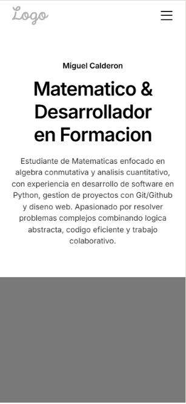
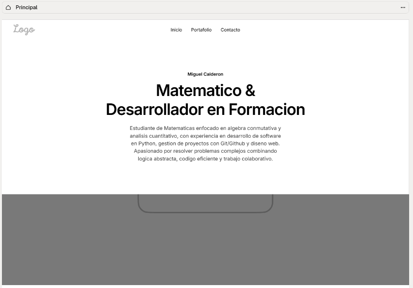

#### Perfil profesional y sobre mí
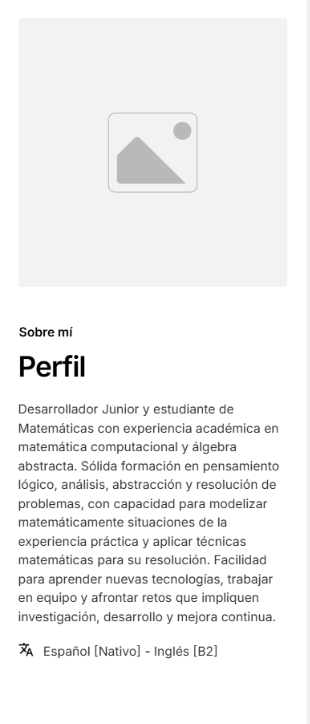
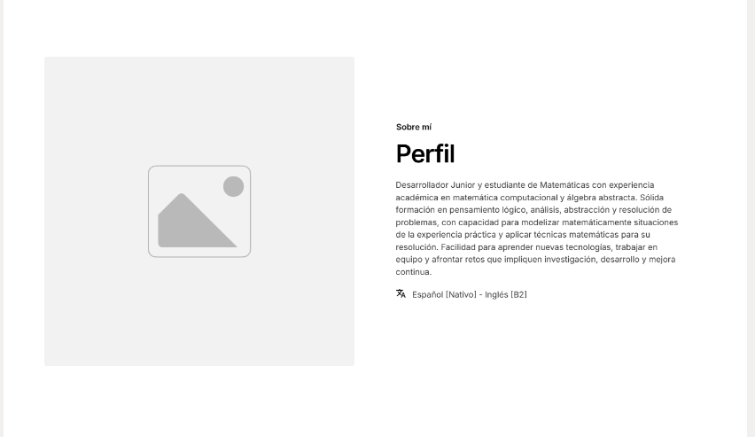

#### Formación y trayectoria
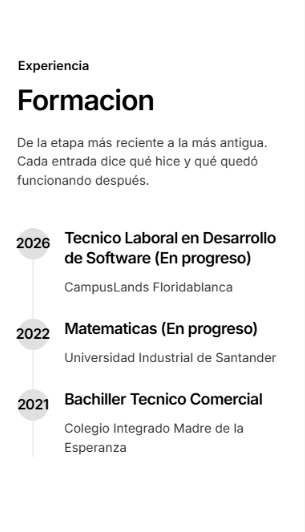
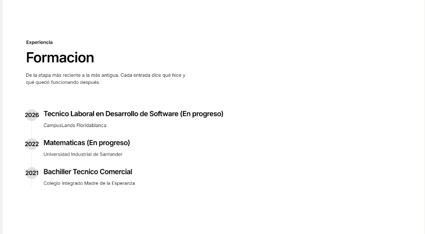

#### Habilidades
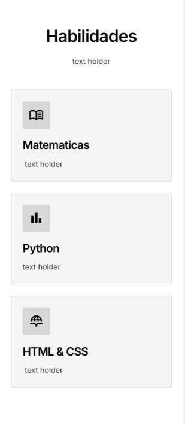
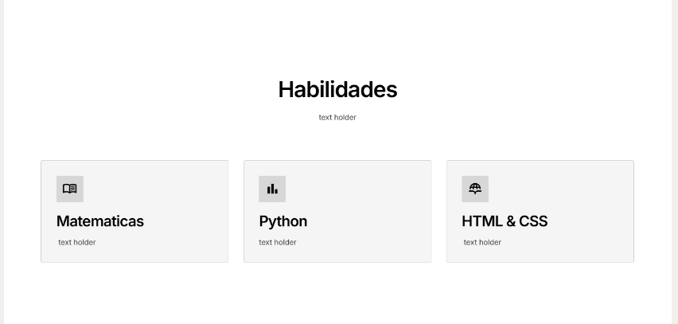

#### Llamado a la acción y pie de página
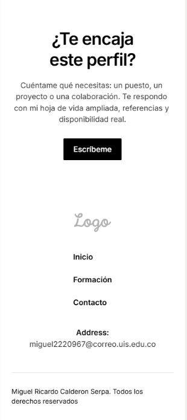
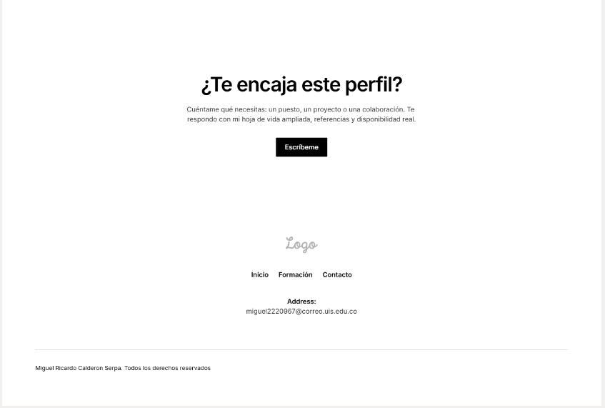

### Portafolio
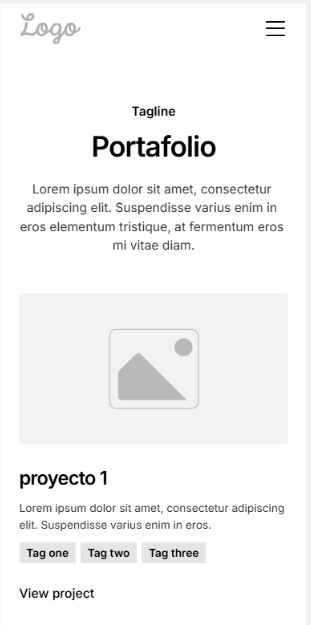
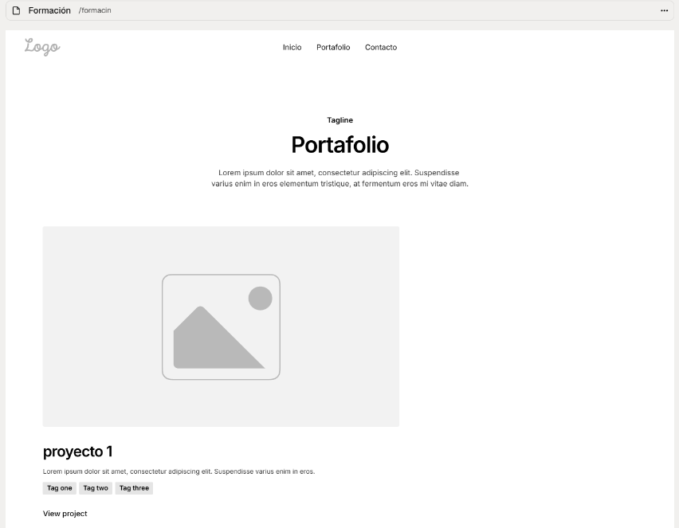

### Contacto
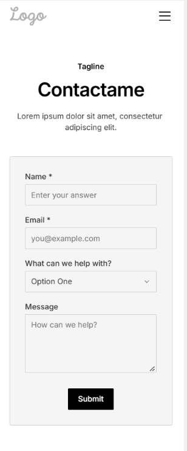
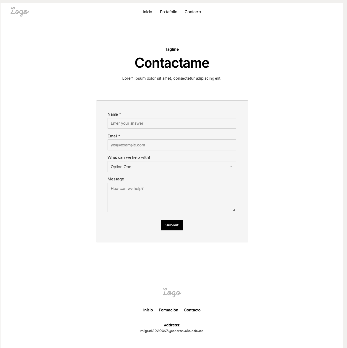

## Capturas del sitio publicado
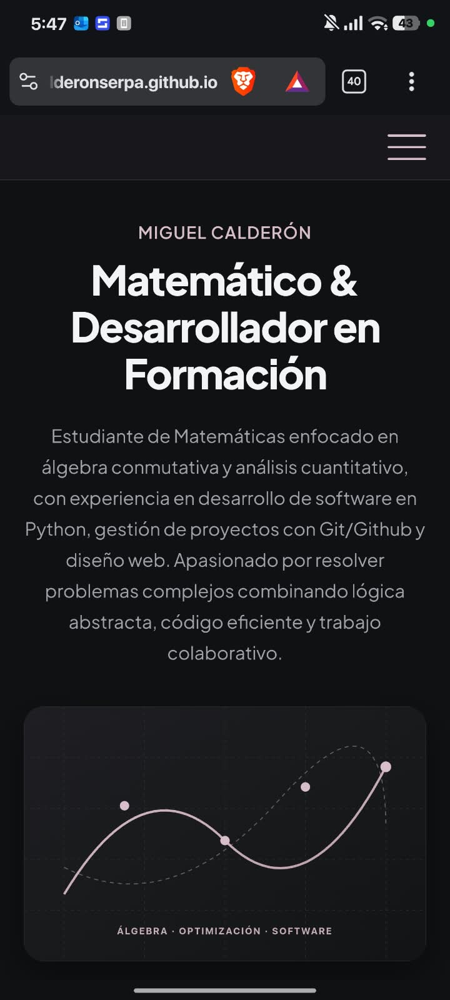

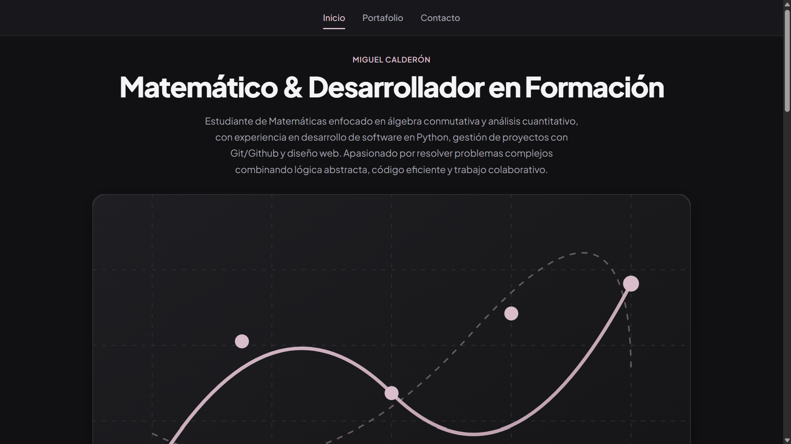
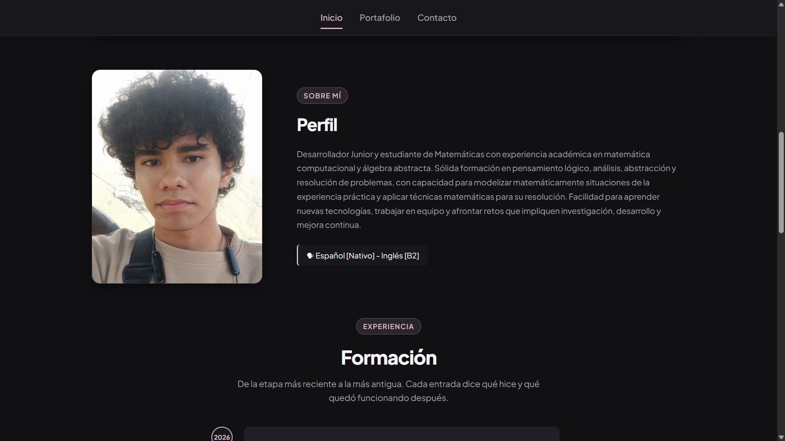

## Breakpoints
- **Base (celular - menor a 600px):**
  - Maquetación en una sola columna vertical para facilitar la lectura y navegación en pantallas reducidas.
  - El menú de navegación se oculta tras un botón hamburguesa accesible (`aria-expanded`) con despliegue vertical interactivo.
  - La sección de perfil y las tarjetas de proyecto apilan la imagen arriba y la información debajo mediante `grid-template-areas: "photo" "info"` y `"media" "info"`.
  - La rejilla de tarjetas de habilidades utiliza `display: grid; grid-template-columns: repeat(auto-fit, minmax(16rem, 1fr))` ocupando el ancho del dispositivo de forma fluida.

- **Desde 600px (37.5rem - tabletas y pantallas medianas):**
  - Las tarjetas de habilidades se redistribuyen de forma fluida a 2 columnas con `repeat(auto-fit, minmax(14rem, 1fr))` y separación de `1.5rem`.
  - Aumento proporcional y jerárquico del tamaño de los encabezados (`h1` a `2.75rem`, `h2` a `2.25rem`).
  - La tarjeta del formulario de contacto amplía su relleno interno (`padding: 2.5rem 2.25rem`) y el botón de envío se ajusta a un ancho contenido (`min-width: 10rem`).

- **Desde 1024px (64rem - computadores de escritorio):**
  - La cabecera oculta el botón hamburguesa (`display: none`) y presenta los enlaces de navegación en línea horizontal centrados (`justify-content: center; flex-direction: row; gap: 2rem;`) con indicador visual inferior animado sobre el enlace activo.
  - La sección de perfil adopta una disposición horizontal en paralelo mediante `grid-template-areas: "photo info"` con columnas `20rem 1fr` y espaciado de `4rem`.
  - Las tarjetas de proyectos del portafolio se organizan en 2 columnas contiguas (`grid-template-areas: "media info"` con columnas `1.1fr 1fr`).
  - La rejilla de tarjetas de habilidades se expande a 3 columnas completas mediante `repeat(auto-fit, minmax(18rem, 1fr))` con una separación de `2rem`.

## Fuentes consultadas
- [Documentación oficial de GitHub Pages](https://docs.github.com/es/pages)
- [Servicio de Validación de Marcado W3C](https://validator.w3.org/)
